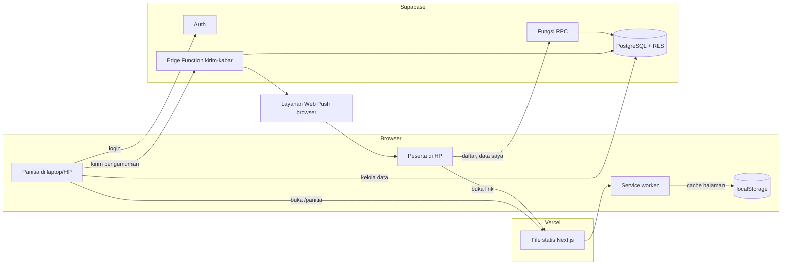
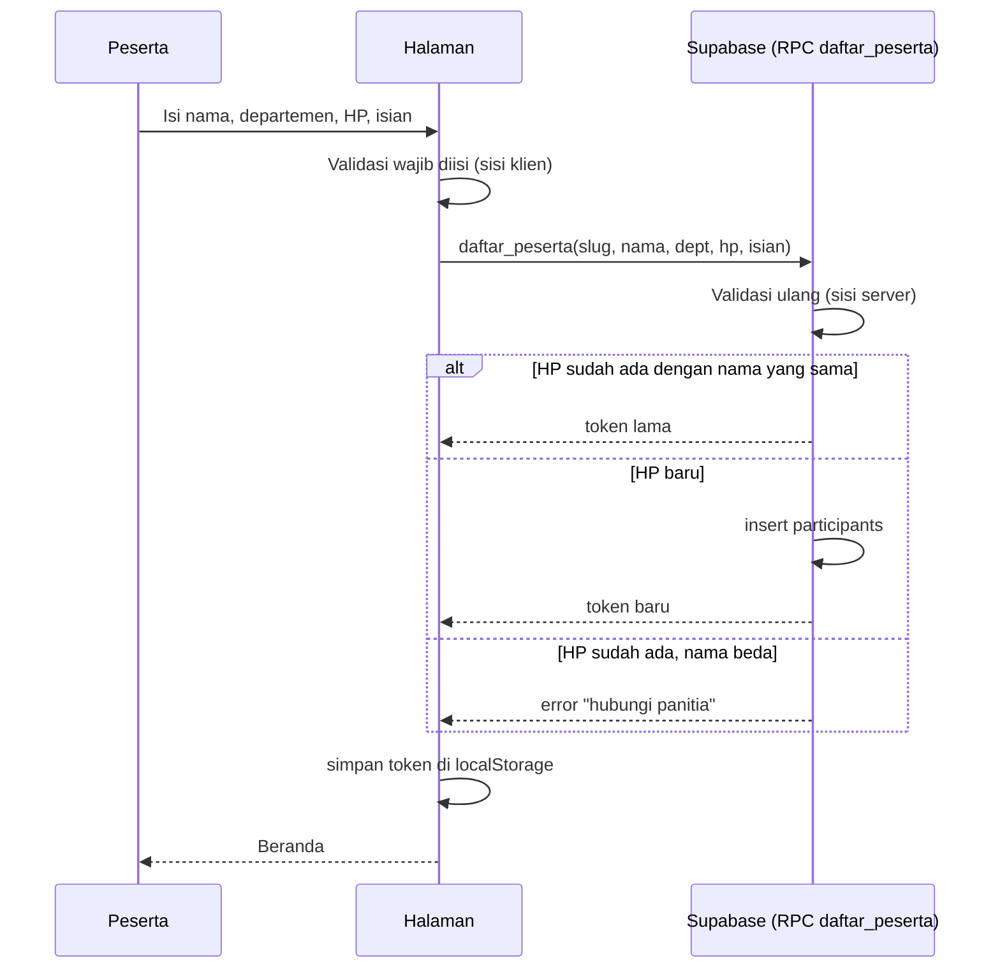

# Arsitektur Info Trip

## Gambaran umum

Aplikasi ini terdiri dari dua bagian yang dikirim sebagai satu paket file statis:

1. **Sisi peserta** (`/?t=<slug>`): dibuka dari link trip. Tanpa login. Peserta mengakses datanya memakai token rahasia yang disimpan di HP.
2. **Sisi panitia** (`/panitia`): login dengan akun Supabase Auth. Hanya akun yang terdaftar di tabel `staff` yang bisa mengubah data.

Browser berbicara langsung ke Supabase lewat klien JavaScript dengan kunci anon. Semua aturan akses ditegakkan di database (RLS dan fungsi `SECURITY DEFINER`), bukan hanya di kode frontend.



## Struktur folder

```
src/
  app/
    page.tsx              Halaman utama: landing dan pintu masuk peserta
    panitia/page.tsx      Halaman panel panitia
    layout.tsx            Layout global, lebar HP
    manifest.ts           Manifest PWA (ikon, nama, mode standalone)
  components/
    peserta/              Tampilan peserta: registrasi, beranda, jadwal, kartu, info, notifikasi
    panitia/              Panel panitia: ringkasan, peserta, absensi, dokumen, pengumuman, jadwal, pengaturan
    Kerangka.tsx          Kerangka skeleton saat memuat
    Ikon.tsx              Kumpulan ikon SVG
  lib/
    supabase.ts           Klien Supabase dan penerjemah pesan error
    data-peserta.ts       Daftar peserta, simpan token, ambil paket data
    panitia.ts            Fungsi panel panitia, termasuk ekspor CSV
    simpan.ts             Penyimpanan lokal (localStorage) dengan langganan perubahan
    notifikasi.ts         Pendaftaran Web Push dari browser
    agenda.ts, waktu.ts, jam.ts   Logika jadwal dan zona waktu
    contoh.ts             Data contoh untuk skeleton saat kunjungan pertama
    types.ts              Tipe data bersama
  ...
public/
  sw.js                   Service worker (cache jaringan-dulu, push)
  icon-192.png, icon-512.png
supabase/
  schema.sql              Tabel, RLS, dan fungsi
  seed-demo.sql           Trip contoh
  staff.sql               Menambahkan akun panitia
  functions/kirim-kabar/  Edge Function pengirim notifikasi
```

## Alur utama

### Registrasi peserta



Validasi ulang di server penting karena pemeriksaan di klien bisa dilewati. Fungsi `daftar_peserta` memeriksa nama, format HP, departemen dari daftar trip, isian wajib, dan pilihan yang valid.

### Membuka data peserta

Setiap kali halaman dibuka, aplikasi memanggil `data_saya(token)`. Fungsi ini hanya mengembalikan data milik token tersebut: profil, bus, kamar, teman sekamar, absensi, dan pesan pribadi. Tabel `participants` tidak bisa dibaca langsung oleh anon.

### Offline

- Service worker menyimpan halaman dan aset setelah pertama kali dibuka.
- Data trip dan data peserta disalin ke `localStorage` (`infotrip:trip:*`, `infotrip:saya:*`) sehingga bisa ditampilkan saat jaringan putus.
- Permintaan ke Supabase tidak di-cache oleh service worker. Data yang tampil saat offline adalah salinan terakhir.

### Absensi

Panitia memindai QR kartu peserta di titik absen. Setiap pasangan `participant_id` dan `titik` hanya boleh tercatat sekali (constraint `unique`).

### Notifikasi

1. Panitia menulis pengumuman atau pesan pribadi.
2. Aplikasi memanggil Edge Function `kirim-kabar` dengan token panitia.
3. Edge Function memeriksa peran owner, lalu mengambil langganan Web Push lewat `bahan_kirim_notifikasi` (hanya service role).
4. Notifikasi dikirim ke setiap endpoint. Endpoint yang sudah mati dihapus lewat `hapus_langganan_mati`.

## Keputusan desain dan alasannya

- **Static export.** Hosting statis murah dan mudah dipindahkan. Tidak ada server yang harus dijaga.
- **Keamanan di database.** Aplikasi bisa dibongkar siapa saja, jadi aturan akses harus tetap berlaku walau kode frontend diubah. Karena itu RLS dan fungsi `SECURITY DEFINER` memegang aturannya.
- **Peserta tanpa akun.** Brief meminta registrasi sekali dengan nama dan HP, tanpa password. Token acak di HP menggantikan login.
- **Fungsi `private` untuk pemeriksaan peran.** Fungsi `private.is_staff()` dan `private.is_owner()` tidak bisa dipanggil lewat API publik.
- **Satu skema yang bisa diulang.** `schema.sql` aman dijalankan ulang (`if not exists`, `drop policy if exists`). Catatan: fungsi `daftar_peserta` dan `data_saya` didefinisikan beberapa kali di file itu. Versi terakhir yang berlaku, tapi sebaiknya dirapikan (lihat [database-schema.md](database-schema.md)).

## Dependensi eksternal

| Layanan | Untuk apa | Catatan |
|---|---|---|
| Supabase | Database, login, Edge Function | Kunci anon ada di browser, aman karena RLS |
| Vercel atau hosting statis | Menyajikan file `out/` | Tidak butuh konfigurasi server |
| Google Maps | Tautan petunjuk arah dan peta titik kumpul | Hanya tautan dan iframe |
| WhatsApp | Tombol tanya panitia dan kirim ke grup | Hanya tautan `wa.me` |
| Layanan Web Push browser | Notifikasi HP | Dikelola browser peserta |

## Batasan yang diketahui

- Tidak ada rate limit di fungsi `daftar_peserta`. Pendaftaran massal bisa dilakukan.
- Ekspor "Excel" sebenarnya CSV dengan BOM, supaya bisa dibuka Excel dengan benar.
- Bagian skeleton dan data contoh di `contoh.ts` hanya tampil saat kunjungan pertama, sebelum data sebenarnya tersimpan.
