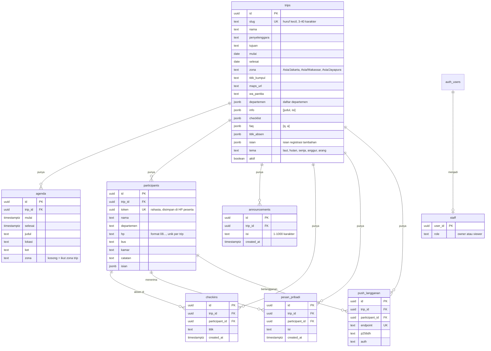

# Skema Database

Database: PostgreSQL di Supabase. Skema lengkap ada di [supabase/schema.sql](supabase/schema.sql).

## Diagram relasi

Catatan: `auth_users` adalah tabel `auth.users` milik Supabase, bukan tabel aplikasi.

## Aturan penting

- **`participants.hp` unik per trip** (`unique (trip_id, hp)`). Nomor yang sama tidak bisa dipakai dua kali di trip yang sama.
- **`participants.token` unik dan acak.** Token ini kunci akses data peserta. Jangan dibagikan.
- **`checkins` unik per peserta per titik.** Absen ganda ditolak di database.
- **`staff.role`** hanya `owner` atau `viewer`. Viewer hanya bisa membaca.
- **Pemeriksaan format HP** di constraint `^08[0-9]{8,11}$`. Fungsi `daftar_peserta` juga menormalkan `+62` menjadi `08`.

## Kebijakan akses (RLS)

| Tabel | Anon | Authenticated (staff) | Owner |
|---|---|---|---|
| trips | baca jika `aktif` | baca semua | kelola |
| agenda | baca jika trip aktif | baca | kelola |
| announcements | baca jika trip aktif | baca | kelola |
| participants | tidak bisa | baca | ubah dan hapus |
| checkins | tidak bisa | baca | tulis dan hapus |
| pesan_pribadi | tidak bisa | baca | tulis dan hapus |
| push_langganan | tidak bisa (tanpa policy) | tidak bisa | tidak bisa |
| staff | tidak bisa | baca baris sendiri | tidak bisa |
| private.konfigurasi | tidak bisa | tidak bisa | tidak bisa (hanya service role) |

Data peserta hanya bisa diakses lewat fungsi RPC:

| Fungsi | Siapa | Fungsi |
|---|---|---|
| `daftar_peserta(slug, nama, departemen, hp, isian)` | anon, authenticated | Registrasi, atau mengembalikan token lama bila nomor dan nama cocok |
| `data_saya(token)` | anon, authenticated | Data milik satu token |
| `simpan_langganan(token, endpoint, p256dh, auth)` | anon, authenticated | Simpan langganan notifikasi peserta |
| `kunci_publik_notifikasi()` | anon, authenticated | Kunci publik VAPID untuk browser |
| `jumlah_langganan(trip)` | authenticated (staff) | Jumlah peserta yang berlangganan |
| `bahan_kirim_notifikasi(trip, peserta)` | service role | Data untuk Edge Function |
| `hapus_langganan_mati(endpoints)` | service role | Bersih-bersih langganan yang tidak aktif |

Semua fungsi `SECURITY DEFINER` memakai `set search_path = public`, supaya tidak bisa dibajak lewat schema lain.

## Catatan migrasi

- `schema.sql` aman dijalankan ulang, tapi `daftar_peserta` dan `data_saya` didefinisikan lebih dari sekali. Versi terakhir yang berlaku.
- Kolom yang ditambahkan belakangan memakai `alter table ... add column if not exists`.
- Setelah perubahan langsung di SQL Editor, sebaiknya bandingkan skema live dengan file ini supaya tidak terjadi drift.
